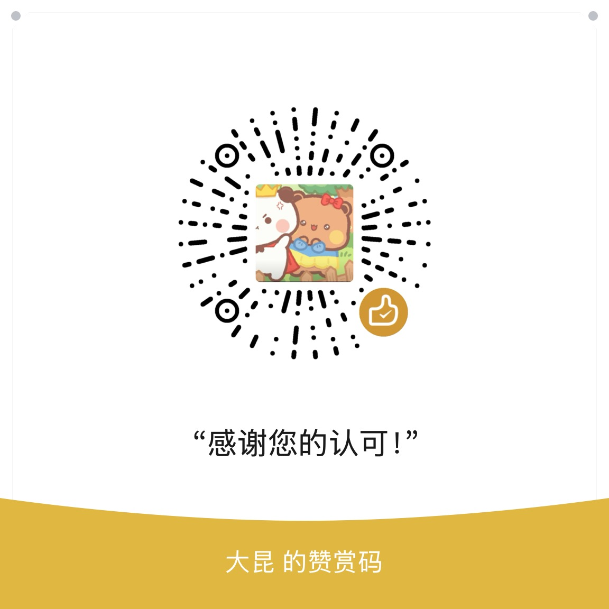

# 一二布布桌面陪伴

跟随键盘和鼠标动作的桌面陪伴应用，提供 **Mac 版和 Windows 版**，免费测试、非官方个人项目。

## 按你的电脑系统下载

| 你的电脑 | 对应版本 | 下载 |
| --- | --- | --- |
| **Mac：macOS 14 及以上**，Apple 芯片（M 系列）或 Intel | **macOS v0.4.0-beta.3 Universal 通用版** | [下载 Mac DMG（推荐）](https://github.com/Li-Jiangjiu/YierBubu/releases/download/v0.4.0-beta.3/YierBubu-macOS-Universal-v0.4.0-beta.3.dmg) · [Mac ZIP](https://github.com/Li-Jiangjiu/YierBubu/releases/download/v0.4.0-beta.3/YierBubu-macOS-Universal-v0.4.0-beta.3.zip) |
| **Windows 10 / Windows 11，64位 Intel 或 AMD** | **Windows v0.5.0-beta.1 x64 便携版** | [下载 Windows ZIP](https://github.com/Li-Jiangjiu/YierBubu/releases/download/v0.5.0-beta.1-windows/YierBubu-Windows-x64-v0.5.0-beta.1.zip) |

- **Mac 用户选择 DMG 或 Mac ZIP；Windows 用户选择 Windows ZIP。** 两个平台分别维护版本号，Windows 版本号更高不表示 Mac 需要升级。
- [Mac 版发布说明与校验文件](https://github.com/Li-Jiangjiu/YierBubu/releases/tag/v0.4.0-beta.3)
- [Windows 版发布说明与校验文件](https://github.com/Li-Jiangjiu/YierBubu/releases/tag/v0.5.0-beta.1-windows)
- 普通用户请选择上表中的安装包。GitHub 自动生成的 **Source code** 压缩包是对应标签的仓库内容，**不是可直接运行的安装包**。
- Windows 首版不包含32位或原生ARM64版本，建议使用已更新的 Windows 10/11；不承诺所有历史 Windows 10 版本。

## Windows 版：解压后直接运行

1. 下载 **YierBubu-Windows-x64-v0.5.0-beta.1.zip**，右键选择“全部解压”。
2. 保留完整的 **YierBubu** 文件夹，双击里面的 **YierBubu.exe**。无需安装 .NET、Python、开发环境，无需管理员权限；不要只复制 EXE。
3. 在屏幕右下角托盘找到小熊图标；如果没看到，点向上箭头展开隐藏图标。右键可显示/隐藏、选择75%/100%/125%大小、开启鼠标穿透、恢复位置、播放动作演示、查看连接状态与计数、退出。
4. 切换到其他软件按字母/数字、点击鼠标或滚动，确认小熊有动作且真实计数增加。动作演示不会增加真实输入计数。
5. 更新前先从托盘退出旧版，再完整解压新版。卸载时退出应用，再删除整个 YierBubu 文件夹。

Windows 版尚未商业代码签名，可能出现无法识别发布者或 SmartScreen 提醒。请核对来源与校验值，不要关闭安全软件。锁屏、安全桌面和受保护程序等场景不尝试绕过系统限制。

Windows 安装 ZIP 的 SHA256：
```text
8e1fff251fbd729a51b8ebca08f756f1ff59fd13d51fc7d9ce53d1deb98a2695
```

## Mac 版：安装与输入监控

1. 更新前，从屏幕顶部小熊菜单选择“退出一二布布”。
2. 打开 DMG，将 YierBubu.app 拖入 Applications（应用程序），完成后弹出镜像。ZIP 用户先解压，再将 App 拖入应用程序。
3. 从“应用程序”打开 App。本版未经过 Apple 公证，确认来源后，若系统阻止打开，可进入“系统设置 → 隐私与安全性”，按系统提供的“仍要打开”流程确认。不要关闭系统安全保护。
4. 点击顶部菜单栏的小熊符号 `ʕ•ᴥ•ʔ`，选择“连接键盘与查看状态…”，申请输入监控。在系统输入监控列表中，用 ＋ 选择应用程序中的本版 App 并开启授权。
5. 按系统提示重新打开，切换到其他软件打字、点击和滚动，确认显示“监听中”且真实计数增加。

免费测试版每次内容更新使用独立权限标识，需要为新版本重新授权；旧条目已经打开不能代替本次授权。动作演示能播放不代表已获得输入权限。


## 验证范围与版本说明

**Windows v0.5.0-beta.1：** 维护者已在自己的 Windows 台式机测试并反馈可用；尚未补充该台机器的具体系统版本和CPU信息，不据此声称所有系统/芯片实测通过。68项核心测试、本地11项素材与归档检查通过；Windows Server 2022/2025、Windows 11 ARM上的x64模拟云端检查通过，安装包完成真实x64 PE、自包含运行库、素材/运行库声明和ZIP重解压验证。混合DPI多屏、各系统版本、Intel/AMD分别实机和长期睡眠唤醒未全面验收；托管桌面的交互式焦点检查有覆盖限制。热插拔设备可能清空一次正在按住的动作。包内 RELEASE-INFO 保留制作时状态，上述实机反馈是制作后的补充。

**Mac v0.4.0-beta.3：** 修复旧版本签名与输入监控授权规则冲突。用户已反馈 MacBook Air 2020（Intel Core i5、8GB、macOS 15.7.9）重新授权后输入恢复。核心33项、发布回归21项通过；Apple 芯片与 Rosetta 的窗口/动画检查各38项通过。Rosetta 不等同于实体 Intel 实测，用户反馈不代表所有设备和长期场景均已验收。

两个版本均只显示主键盘数字与字母36键，按物理键位反馈；其他布局、媒体键、多屏、全屏、系统安全输入等场景未全面验证。

## 隐私与卸载

两个版本均只用当前物理键位、鼠标按钮和滚动方向驱动动画，不读取输入文字、不记录输入历史、不联网、不发送模拟输入。临时状态和次数仅在运行期间保留，当前没有开机自启。

- **Windows：** 从右下角托盘退出，再删除整个 YierBubu 文件夹。
- **Mac：** 从顶部小熊菜单退出，再将“应用程序”中的 YierBubu.app 移至废纸篓；可按需移除输入监控条目。
- 隐藏小熊只隐藏画面，不等于退出。

## 源码、角色素材与使用说明

[Windows 独立实现源码](https://github.com/Li-Jiangjiu/YierBubu/tree/codex/windows-desktop/windows)已在开发分支公开，[PR #2](https://github.com/Li-Jiangjiu/YierBubu/pull/2)提供变更与验证记录；代码采用该分支的 [MIT 许可证](https://github.com/Li-Jiangjiu/YierBubu/blob/codex/windows-desktop/LICENSE)。macOS 应用源码尚未整理公开。

角色原作黄小B，本项目非官方。**角色形象、名称、图标、PNG、商标和第三方参考素材不属于代码 MIT 授权。** 角色素材公开分发授权尚未确认，免费提供应用不代表取得角色权利方授权，也不授予素材再分发许可。

反馈问题时，请说明 **Mac 或 Windows**、系统版本、CPU/芯片、App版本、监听状态及复现步骤，不需要提供输入文字或其他私人内容。

## 项目来源与致谢

本项目基于 [ayangweb/BongoCat](https://github.com/ayangweb/BongoCat) 的桌面陪伴交互思路，在其产品设计以及输入、平台、窗口模块职责划分的参考基础上开展一二布布的开发工作。感谢 ayangweb 和 BongoCat 项目的分享与启发。

本项目的 macOS Swift 和 Windows C# 实现独立编写，没有复制或翻译 BongoCat 的实现代码，也没有使用其猫咪模型或 Live2D 素材。

## 支持与赞赏

每一份认可我都心怀感激。欢迎赞赏，但绝不强求——感谢喜欢一二布布的你❤️


